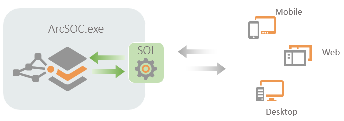
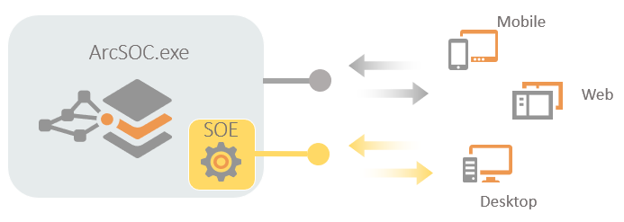

# arcgis-enterprise-sdk-resources

This repository provides samples and code snippets for **server object extensions (SOEs)**, **server object interceptors (SOIs)**, **custom data feeds (CDFs)**, and **service interceptors** developed with **ArcGIS Enterprise SDK 12.2**. To learn more, visit the [ArcGIS Enterprise SDK documentation](https://developers.arcgis.com/enterprise-sdk/).

> Note: If you want to download the SOE, SOI or Custom data feeds (CDF) samples built with 12.1 or previous versions of ArcGIS Enterprise SDK, refer to [Releases branch](https://github.com/Esri/arcgis-enterprise-sdk-resources/tree/release-v11.5.0?tab=readme-ov-file).

## Extension types

### Server object interceptors (SOIs)

An SOI is capable of intercepting REST, SOAP, and OGC requests and responses of a map service in the following way:

  

### Server object extensions (SOEs)

An SOE is capable of extending the functions of a map service in the following way:

  

### Custom data feeds (CDFs)

CDFs provide access to data sources that ArcGIS does not natively support. Custom data providers written in JavaScript and Node.js can expose external data through feature services in ArcGIS Server. For more information, see [What are Custom Data Feeds](https://developers.arcgis.com/enterprise-sdk/guide/custom-data-feeds/).

### Service interceptors

Service interceptors inspect and modify HTTP requests and responses for **REST-based services** published to ArcGIS Enterprise, including hosted feature services. They can be used for auditing, access control, request validation, response enrichment, and other custom workflows. Service interceptors are developed in Java and are distinct from SOIs. For more information, see [What are service interceptors?](https://developers.arcgis.com/enterprise-sdk/guide/service-interceptors/what-are-service-interceptors/).

## Features

- [Samples and sample data](Samples/ReadMe.md)
- .NET and Java SOE and SOI samples
- Custom data feed samples
- Service interceptor samples, including audit logging, access control, chaining, and incident management

## Instructions

1. Clone this repository. Fork it first if you plan to contribute changes.
2. Open the [Samples README](Samples/ReadMe.md) for the available samples, sample data, and setup instructions.
3. Review the prerequisites for the sample you want to run.
4. Build and deploy the sample as described in its README, then test it with a compatible ArcGIS Server service.

## Requirements

The software required depends on the sample type:

- **ArcGIS Enterprise or standalone ArcGIS Server:** Required to deploy and test extensions, service interceptors, and CDF providers.
- **ArcGIS Enterprise SDK 12.2:** Required for developing and building the 12.2 samples.
- **.NET SOE and SOI samples:** Microsoft Visual Studio and the .NET SDK version supported by ArcGIS Enterprise SDK 12.2.
- **Java SOE, SOI, and service interceptor samples:** A Java IDE, such as IntelliJ IDEA or Eclipse, plus a supported JDK and Apache Maven.
- **Custom data feed samples:** Node.js and an IDE or text editor. Install a Node.js version compatible with the target SDK and ArcGIS Server version.
- **ArcGIS Pro:** Used to prepare and publish map or image services needed by SOE and SOI samples. It is not required to develop CDFs or service interceptors, although some samples may use services or data published from ArcGIS Pro.

Refer to the [ArcGIS Enterprise SDK documentation](https://developers.arcgis.com/enterprise-sdk/) for the exact software versions and platform prerequisites.

> **Service compatibility:** SOEs and SOIs extend supported map or image services and applicable service capabilities; they are **not** used directly with hosted feature services. Service interceptors support REST-based services, including hosted feature services, but do **not** intercept SOAP or OGC traffic. CDFs expose external data as feature services. Review each sample's README for its specific service requirements.

## Resources

- [ArcGIS Enterprise SDK Developer Guide](https://developers.arcgis.com/enterprise-sdk/)
- [ArcGIS Server – Introduction to extending services](https://doc.esri.com/en/arcgis-enterprise/latest/administer/about-extending-services.html)
- [ArcGIS Server – Custom data feeds](https://doc.esri.com/en/arcgis-enterprise/latest/administer/custom-data-feeds.html)
- [Service interceptor guide](https://developers.arcgis.com/enterprise-sdk/guide/service-interceptors/what-are-service-interceptors/)
- [Custom data feeds guide](https://developers.arcgis.com/enterprise-sdk/guide/custom-data-feeds/)

## Issues
Find a bug or want to request a new feature?  Please let us know by submitting an issue or [contact Technical Support](https://support.esri.com/en/contact-tech-support).

## Contributing
Esri welcomes contributions from anyone and everyone. Please see our [guidelines for contributing](https://github.com/esri/contributing).

## Licensing
Copyright 2026 Esri

Licensed under the Apache License, Version 2.0 (the "License");
you may not use this file except in compliance with the License.
You may obtain a copy of the License at

   http://www.apache.org/licenses/LICENSE-2.0

Unless required by applicable law or agreed to in writing, software
distributed under the License is distributed on an "AS IS" BASIS,
WITHOUT WARRANTIES OR CONDITIONS OF ANY KIND, either express or implied.
See the License for the specific language governing permissions and
limitations under the License.

A copy of the license is available in the repository's [License.txt](https://github.com/hanhansun/arcgis-enterprise-sdk-samples/blob/master/License.txt) file.
