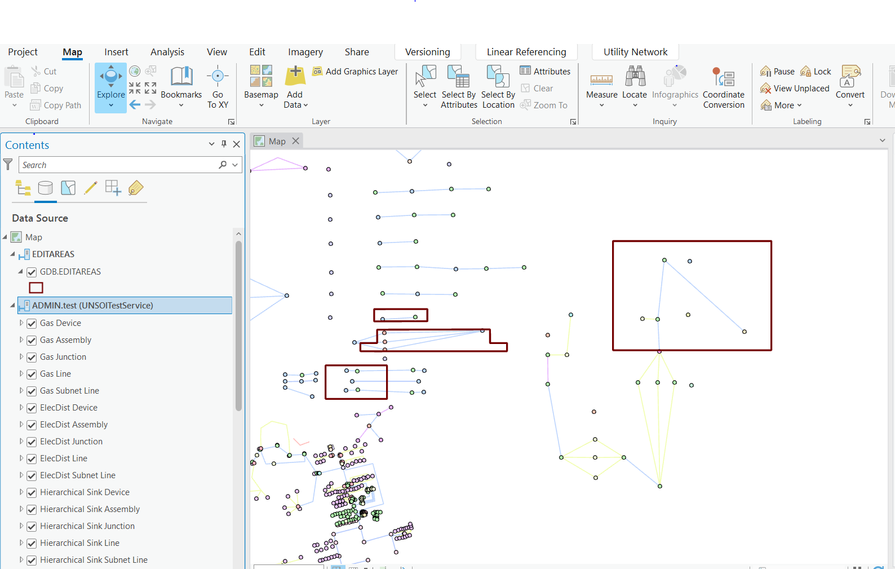

# .NET utility network edit areas collaboration REST SOI

This sample demonstrates how to track network areas being edited by leveraging the utility network's dirty areas table. The SOI intercepts the [Validate Network Topology](https://developers.arcgis.com/rest/services-reference/validatenetworktopology-utiility-network-server-.htm) REST operation and processes the dirty areas to create a polygon feature in a shared, non-versioned feature class. This feature class is published as a feature layer and added to the same ArcGIS Pro project as the utility network layers.

To use this SOI, the administrator must first create a non-versioned feature class in the same enterprise geodatabase as the utility network dataset. The feature class must be owned by the same user who owns the utility network dataset and must contain the required fields described in the Sample data section.

This sample was demonstrated at the [Esri Developer Summit plenary](https://www.esri.com/arcgis-blog/products/arcgis/administration/dev-summit-2021-extend-and-automate-your-intelligent-enterprise/). Watch the demonstration in[Extending and Automating Your Enterprise](https://www.youtube.com/watch?v=hHFLSLXczGY).

The administrator must enable the SOI on a map service that has the Utility Network capability enabled. The utility network owner must also ensure that the network topology is enabled.

You can deploy the SOI using the precompiled .soe file (..\NetUNEditAreasSOI\bin\Release\NetUNEditAreasSOI_ent.soe) without opening Visual Studio. To debug, modify, or rebuild the SOI, open the project (..\NetUNEditAreasSOI\NetUNEditAreasSOI.csproj) in Visual Studio. You may need to update the constant values to match your environment.

## Features
  * Opening a Utility Network dataset (`IFeatureDataset`, `IDataset`)
  * Getting network properties and dirty areas table (`IBaseNetwork`, `IDEBaseNetwork`)
  

This sample does not require a specific utility network dataset. You can use a utility network published from an enterprise geodatabase.

For example, refer to the [Electric Utility Network Foundation](https://doc.arcgis.com/en/arcgis-solutions/latest/reference/introduction-to-electric-utility-network-foundation.htm) solution for sample data and configuration guidance.

### Create the edit areas feature class

Create a non-versioned polygon feature class named `EditAreas` in the same enterprise geodatabase as the utility network, under the same owning user.

The feature class must contain the following fields:

- OBJECTID (Object ID)
- CREATIONDATE (Date)
- LASTUPDATE (Date)
- EDITCOUNT (Long)
- VERSIONNAME (Text)
- CREATOR (Text)
- SHAPE (Geometry)

## Instructions

### Deploy the SOI

1. Log in to ArcGIS Server Manager and click the ***Site*** tab.
2. Click ***Extensions***.
3. Click ***Add Extension***.
4. Click ***Choose File*** and choose the ***NetUNEditAreasSOI_ent.soe*** file (`..\NetUNEditAreasSOI
\bin\Release\NetUNEditAreasSOI_ent.soe` or `..\NetUNEditAreasSOI\bin\Debug\NetUNEditAreasSOI_ent.soe`).
5. Click ***Add***.

### Publish both services

1. Using ArcGIS Pro, follow the steps listed in [Publish and consume services with a utility network](https://pro.arcgis.com/en/pro-app/latest/help/data/utility-network/publishing-and-consuming-services-with-the-utility-network.htm) to publish the utility network layers.
2. Still using ArcGIS Pro, connect to the Enterprise Geodatabase as the utility network owner and publish the edit areas feature layer as a service (non-versioned).

### Enable the SOI on a map service

1. Make sure you have published the utility network service whose data source is from an Enterprise Geodatabase using ArcGIS Pro. If not, refer to [Electric Utility Network Foundation](https://solutions.arcgis.com/electric/help/electric-utility-network-foundation/).
2. Log in to ArcGIS Server Manager and click the ***Services*** tab. Select the utility network map service and select ***Capabilities***.
3. Under ***Interceptors***, select ***NetUNEditAreasSOI*** and click on the right arrow to add it to the list of enabled interceptors.
4. Click the ***Save and Restart*** button to restart the service.

### Create an ArcGIS Pro project
1. In ArcGIS Pro, create a new project and connect to the Portal on which both services have been published.
2. Add both the utility network feature service and the edit areas feature service on a new map.
3. Save the project.

### Test the SOI in ArcGIS Pro

1. Open the ArcGIS Pro project created in the previous step.
2. Create a named branch version of the utility network and switch to it.
3. Edit one or more network features. Modify an attribute that generates a dirty area, such as the asset group or asset type.
4. Save the edits to the named branch version.
5. On the Utility Network tab, use the Validate command to validate the network topology for the current extent.
6. Verify that the dirty areas are cleared and that an edit area polygon is created in the EditAreas feature layer.
7. Delete the named branch version and verify that the corresponding edit area is removed.

  

     
   
