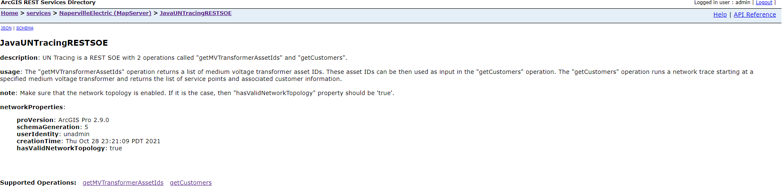

# Java utility network tracing REST SOE

This sample demonstrates how to use utility network tracing capabilities to identify customers served by a medium-voltage transformer.

The SOE provides two REST operations:

- `getMVTransformerAssetIds`: Queries the Electric Device layer and returns a list of medium-voltage transformer asset IDs.
- `getCustomers`: Uses a selected transformer asset ID to trace the utility network and retrieve connected service points and mock customer information.

The root resource of the SOE also returns information about the utility network.

To use this SOE, the administrator must enable it on a map service that has the Utility Network capability enabled. The utility network owner must ensure that the network topology is enabled.

You can deploy the SOE using the compiled .soe file (..\untracingrestsoe\target\JavaUNTracingRESTSOE.soe) without opening a Java IDE. To debug, modify, or rebuild the SOE, open the project (..\untracingrestsoe) in a Java IDE, such as Eclipse or IntelliJ IDEA.

## Features
  * Opening a Utility Network dataset (`IFeatureDataset`, `IDataset`)
  * Getting network properties (`IBaseNetworkProxy`, `IDEBaseNetworkProxy`, `IBaseNetworkTopologyProxy`)
  * Creating and initializing a network tracer (`IBaseNetworkProxy`, `IUtilityNetworkQuery`, `ITracer`, `IDEDataset`)
  * Configuring and executing a network trace (`ITracer`, `UNTraceConfiguration`, `UNCondition`, `UNOutputFilter`)
  * Processing network trace results (`IUNTraceResults`)


## Sample data

This sample uses the Naperville electric utility network demo dataset, published as a utility network service on ArcGIS Enterprise.

The dataset must contain the electric device and service point information required by the sample operations.

For more information about configuring and publishing an electric utility network, see [Electric Utility Network Foundation](https://doc.arcgis.com/en/arcgis-solutions/latest/reference/introduction-to-electric-utility-network-foundation.htm).

Before testing, verify that the published dataset contains the required asset groups, asset types, and attributes expected by this sample.


## Instructions

### Deploy the SOE

1. Log in to ArcGIS Server Manager and click the ***Site*** tab.
2. Click ***Extensions***.
3. Click ***Add Extension***.
4. Click ***Choose File*** and choose the ***JavaUNTracingRESTSOE.soe*** file (`..\untracingrestsoe\target\JavaUNTracingRESTSOE.soe`).
5. Click ***Add***.

### Enable the SOE on a map service

1. Make sure you have published the Naperville electric utility network service whose data source is from an Enterprise Geodatabase using ArcGIS Pro. If not, refer to [Electric Utility Network Foundation](https://solutions.arcgis.com/electric/help/electric-utility-network-foundation/).
2. Log in to ArcGIS Server Manager and click the ***Services*** tab. Select the Naperville map service and select ***Capabilities***.
3. In the list of available capabilities, find ***Java UN Tracing REST SOE*** and check the box to enable it.
4. Click the ***Save and Restart*** button to restart the service.

### Test the SOE in the ArcGIS Server Services Directory

1.  Open a browser and navigate to the REST endpoint of the published Naperville electric utility network map service (URL: `http://<serverdomain>/<webadaptorname>/rest/services/<Naperville>/MapServer`).
2. Scroll to the bottom of the above page and click ***JavaUNTracingRESTSOE*** in ***Supported Extensions***. 
   
   This leads to the SOE's root page, at the following URL:

   ```
   http://<serverdomain>/<webadaptorname>/rest/services/<servicename>/MapServer/exts/JavaUNTracingRESTSOE
   ```
   
   
   
   Make sure that the ***hasValidNetworkTopology*** property returns 'true'. This indicates that the network topology is enabled. Otherwise, the Utility Network owner will need to enable the network topology before using this SOE. 

3. Click ***getMVTransformerAssetIds*** in ***Supported Operations***. 

   Optionally, type a valid WHERE clause for querying transformer devices in the ***where*** input box.
   
   Click the ***getMVTransformerAssetIds*** button. You will receive a response returning the asset IDs of all medium-voltage transformers satisfying the specified where clause:
   
   ``` JSON
   {
	   "assetIds": [
		   "1",
		   "2",
		   "3",
		   "4",
		   "5"
	   ]
   }
   ```
   One of these transformer asset IDs can then be used to get the list of serviced customers.

4. Click ***getCustomers*** in ***Supported Operations*** on the SOE's root page. 

   Type a valid transformer asset ID in the ***transformerAssetId*** input box. 
  
   Click the ***getCustomers*** button. You will receive a response returning more information about the transformer, along with the list of service points containing mocked customer information:
   
   ```bash
   {
    "transformer": {
     "ASSETID": "4",
     "GLOBALID": "{2A364DF8-6BD7-41E7-8B3B-33FF512E47D7}",
     "ASSETGROUP": 15,
     "ASSETTYPE": 522,
     "geometry": {
      "x": 1034890.20694192871,
      "y": 1867360.98282569647,
      "z": 0,
      "m": null,
      "spatialReference": {
       "wkid": 102671,
       "latestWkid": 3435,
       "vcsWkid": 105703,
       "latestVcsWkid": 6360
      }
     }
    },
    "servicePoints": [
     {
      "GLOBALID": "{5788E55C-5078-4B8A-9305-0EF53820C0E8}",
      "ASSETID": "1493",
      "ASSETGROUP": 11,
      "ASSETTYPE": 402,
      "geometry": {
       "x": 1035040.15546092764,
       "y": 1867418.14216019958,
       "z": 0,
       "m": null,
       "spatialReference": {
        "wkid": 102671,
        "latestWkid": 3435,
        "vcsWkid": 105703,
        "latestVcsWkid": 6360
       }
      },
      "customerInfo": {
       "customerID": "XXXXXXXXXX",
       "firstName": "XXXXXXXXXX",
       "lastName": "XXXXXXXXXX",
       "phoneNumber": "XXX-XXX-XXXX",
       "address": "XXXXXXXXXX",
       "city": "XXXXXXXXXX",
       "zipCode": "XXXXX"
      }
     },
     ...
    ]
   }
   ```
   
